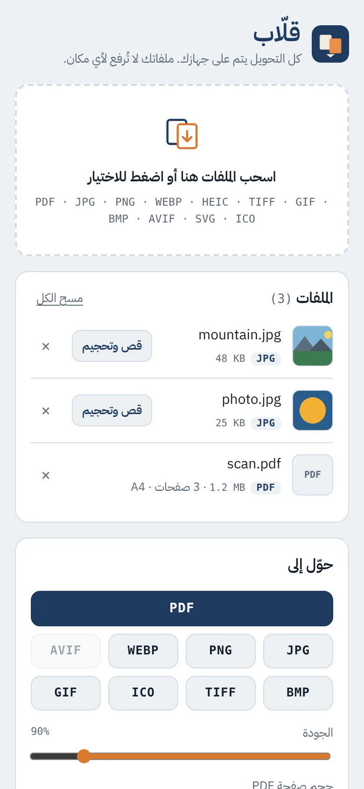
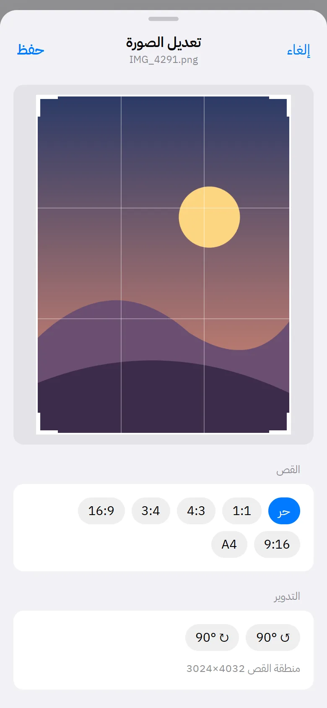
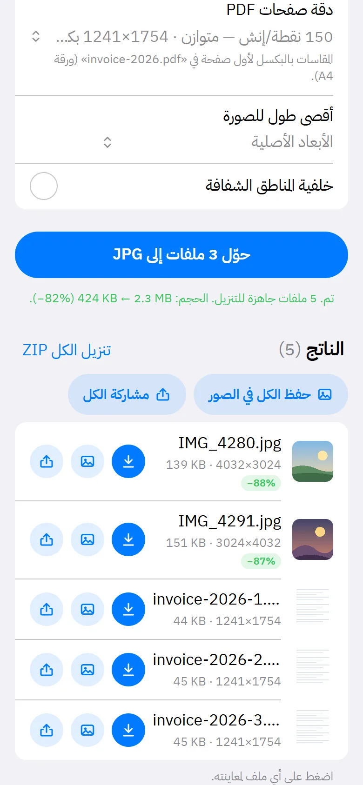
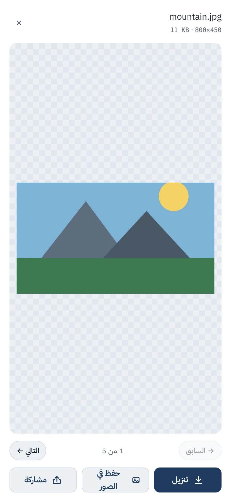

<div dir="rtl" align="right">

<p align="center">
  
</p>

<h1 align="center">قلّاب</h1>

<p align="center">
  <b>حوّل الصور إلى PDF والعكس، وبين كل صيغ الصور، على جهازك نفسه.</b><br>
  بدون رفع ملفات، بدون حساب، ويشتغل حتى بدون إنترنت.
</p>

<p align="center">
  <a href="https://xturki.github.io/qallab/"><b>افتح التطبيق ←</b></a>
</p>

<p align="center">
  
  
  
  
</p>

<p align="center">
  
  
  
  
</p>

---

## ليش قلّاب؟

أغلب مواقع التحويل ترفع ملفاتك لخوادمها: عقود، هويات، صور شخصية. **قلّاب** يسوي كل شي داخل المتصفح، فالملف ما يطلع من جهازك أبداً. تثبّته على الجوال مثل أي تطبيق، ويشتغل في الطيارة أو بدون شبكة بعد أول فتح.

## الميزات

### التحويل
- **صور ← PDF**: صفحة لكل صورة، مع دمج كل الملفات في PDF واحد، ومقاس صفحة بحجم الصورة أو A4 أو Letter.
- **PDF ← صور**: كل صفحة تطلع صورة مستقلة، بدقة من 72 إلى 600 نقطة/إنش.
- **دمج ملفات PDF**: عدة ملفات PDF وصور في ملف واحد، بالترتيب اللي أضفتها فيه.
- **بين صيغ الصور**: من أي صيغة إلى JPG أو PNG أو WEBP أو AVIF أو BMP أو TIFF أو ICO أو GIF.
- **دفعات**: حوّل عشرات الملفات مرة وحدة، ونزّلها كلها في ملف ZIP.

### التحكم في الحجم
- **الجودة**: شريط من 40% إلى 100% لصيغ JPG وWEBP وAVIF والصور داخل PDF.
- **المقاس الفعلي أمام كل دقة**: يعرض مقاس الصفحة بالبكسل، مثل «150 نقطة/إنش · 1240×1754 بكسل». المقاس محسوب من أول صفحة في ملفك، مع التعرّف على A3 وA4 وA5 وLetter وLegal.
- **ضغط PDF**: متوسط (150 نقطة/إنش) أو قوي (100). يحافظ على مقاس الورقة، وإذا طلع الناتج أكبر يبقى الأصل كما هو.
- **أقصى طول للصورة**: من 800 إلى 3840 بكسل لتصغير الصور بضغطة.
- **نسبة التوفير**: كل ملف ناتج يعرض حجمه ونسبة النقص، مثل ‎−66%‎.

### محرر الصور
- **قص** حر أو بنسبة ثابتة: 1:1، 4:3، 3:4، 16:9، 9:16، A4.
- **تدوير** 90° يمين أو يسار.
- **تحجيم** بالبكسل مع قفل النسبة، أو بالنسبة المئوية من 25% إلى 300%، تصغيراً أو تكبيراً.

### المخرجات
- **معاينة** لكل ملف ناتج، بما فيها صفحات PDF وملفات TIFF، مع التنقّل بالسحب أو بالأزرار.
- **تنزيل** إلى تطبيق الملفات أو مجلد التنزيلات.
- **حفظ في الصور** مباشرة من الجوال.
- **مشاركة** إلى واتساب أو البريد أو أي تطبيق، لملف واحد أو للكل.

## الصيغ المدعومة

| | يقرأ | يحفظ |
|---|:---:|:---:|
| PDF | ✓ | ✓ |
| JPG / JPEG | ✓ | ✓ |
| PNG | ✓ | ✓ |
| WEBP | ✓ | ✓ |
| AVIF | ✓ | ✓ ¹ |
| HEIC / HEIF (صور الآيفون) | ✓ | — |
| TIFF (متعدد الصفحات) | ✓ | ✓ |
| GIF | ✓ | ✓ ² |
| BMP | ✓ | ✓ |
| ICO | ✓ | ✓ ³ |
| SVG | ✓ | — |

¹ حسب المتصفح. Chrome وEdge يدعمونه، وSafari لا يدعم الحفظ بصيغة AVIF حالياً، فيظهر الزر معطّلاً.<br>
² بلوحة 252 لوناً، ممتازة للرسومات والشعارات. الصور الفوتوغرافية قد تظهر فيها تدرّجات.<br>
³ مربع بحد أقصى 256×256، مناسب لأيقونات المواقع.

## طريقة الاستخدام

1. اسحب الملفات للصفحة، أو اضغط لاختيارها، أو الصقها مباشرة.
2. اختر **قص وتحجيم** بجانب أي صورة لو تبغى تعدّلها (اختياري).
3. اختر الصيغة المطلوبة، واضبط الجودة والدقة والمقاس.
4. اضغط **حوّل**، ثم اضغط أي ملف ناتج لمعاينته وتنزيله أو حفظه أو مشاركته.

## التثبيت على الجوال

- **آيفون (Safari)**: زر المشاركة ← **إضافة إلى الشاشة الرئيسية**.
- **أندرويد (Chrome)**: زر **تثبيت التطبيق** أعلى الصفحة، أو قائمة المتصفح ← **تثبيت**.
- **الكمبيوتر (Chrome / Edge)**: أيقونة التثبيت في شريط العنوان.

بعد التثبيت يفتح التطبيق في نافذة مستقلة ويشتغل بدون إنترنت.

## الخصوصية

- كل المعالجة تتم في متصفحك بـ JavaScript. ما فيه خادم يستقبل الملفات أصلاً.
- ما فيه تحليلات ولا تتبّع ولا ملفات تعريف ارتباط.
- كل المكتبات والخطوط محفوظة داخل المستودع، فالتطبيق ما يتصل بأي موقع خارجي.

## ملاحظات مهمة

- **ضغط PDF** يعيد رسم كل صفحة كصورة، فيصير النص غير قابل للتحديد أو البحث. استخدمه للملفات الممسوحة ضوئياً أو للإرسال، مو للمستندات اللي تحتاج تنسخ منها.
- **الحفظ في الصور على الآيفون** يمر عبر قائمة المشاركة، ومنها تختار «حفظ الصورة»، لأن المتصفحات ما تسمح للمواقع تكتب في مكتبة الصور مباشرة. على أندرويد تنحفظ الصورة في التنزيلات وتظهر في المعرض.
- **التكبير** يكبّر الصورة لكن ما يضيف تفاصيل جديدة.
- **الملفات الضخمة جداً**، مثل PDF من مئات الصفحات بدقة 600، قد تستهلك ذاكرة كبيرة على الجوالات القديمة.
- **معاينة PDF** تعرض أول 30 صفحة، والملف المحفوظ يحتوي كل الصفحات.

---

## للمطورين

تطبيق ثابت بالكامل: HTML وCSS وJavaScript عادي، بدون إطار عمل أو خطوة بناء.

```
qallab/
├── index.html             الواجهة
├── styles.css             التصميم (فاتح وداكن)
├── app.js                 التحويل والترميز وبناء PDF
├── editor.js              محرر القص والتحجيم ومقاسات الدقة
├── viewer.js              المعاينة والتنزيل والحفظ والمشاركة
├── sw.js                  Service Worker للعمل بدون إنترنت
├── manifest.webmanifest   بيانات تثبيت التطبيق
├── lib/                   المكتبات (محلية)
├── fonts/                 خط IBM Plex Sans Arabic
├── icons/                 أيقونات التطبيق
└── docs/                  لقطات الشاشة
```

### التشغيل محلياً

```bash
git clone https://github.com/xTurki/qallab.git
cd qallab
python3 -m http.server 8080
# افتح http://localhost:8080
```

لازم تشغّله من خادم محلي. فتح `index.html` مباشرة من الملفات ما يشغّل الـ Service Worker.

### النشر

المستودع جاهز لـ **GitHub Pages**: من Settings ← Pages اختر الفرع `main` والمجلد `/ (root)`. ويشتغل كذلك على Netlify أو Cloudflare Pages أو أي استضافة ملفات ثابتة تدعم HTTPS.

### عند التحديث

غيّر رقم الإصدار في أول سطر من `sw.js`، مثلاً `qallab-v5` إلى `qallab-v6`، عشان الأجهزة المثبّت عليها التطبيق تحمّل النسخة الجديدة. وإذا أضفت ملفاً جديداً، أضفه لقائمة `ASSETS` في نفس الملف.

### المكتبات

| المكتبة | الإصدار | الاستخدام | الترخيص |
|---|---|---|---|
| [pdf-lib](https://github.com/Hopding/pdf-lib) | 1.17.1 | إنشاء ودمج PDF | MIT |
| [PDF.js](https://github.com/mozilla/pdf.js) | 3.11.174 | قراءة صفحات PDF ورسمها | Apache-2.0 |
| [heic2any](https://github.com/alexcorvi/heic2any) | 0.0.4 | قراءة صور HEIC | MIT |
| [UTIF.js](https://github.com/photopea/UTIF.js) | 3.1.0 | قراءة وكتابة TIFF | MIT |
| [pako](https://github.com/nodeca/pako) | 2.1.0 | فك ضغط TIFF | MIT / Zlib |
| [JSZip](https://github.com/Stuk/jszip) | 3.10.1 | تنزيل الكل كـ ZIP | MIT |
| [IBM Plex Sans Arabic](https://github.com/IBM/plex) | 5.0.20 | الخط | OFL-1.1 |

مُرمّزات BMP وICO وGIF مكتوبة داخل `app.js` بدون مكتبات.

</div>

---

<div dir="ltr">

### English

**Qallab** (Arabic for *the one who flips things over*) is an installable, offline-first PWA that converts images to PDF and back, and between image formats: JPG, PNG, WEBP, AVIF, HEIC, TIFF, GIF, BMP, ICO and SVG. Everything runs locally in the browser, so files never leave the device. It also merges PDFs, compresses PDFs, shows the exact pixel size for each DPI, and includes a crop / rotate / resize editor, an output viewer, and download, save-to-Photos and share actions. No build step: serve the folder over HTTPS (e.g. GitHub Pages) and it works.

</div>
